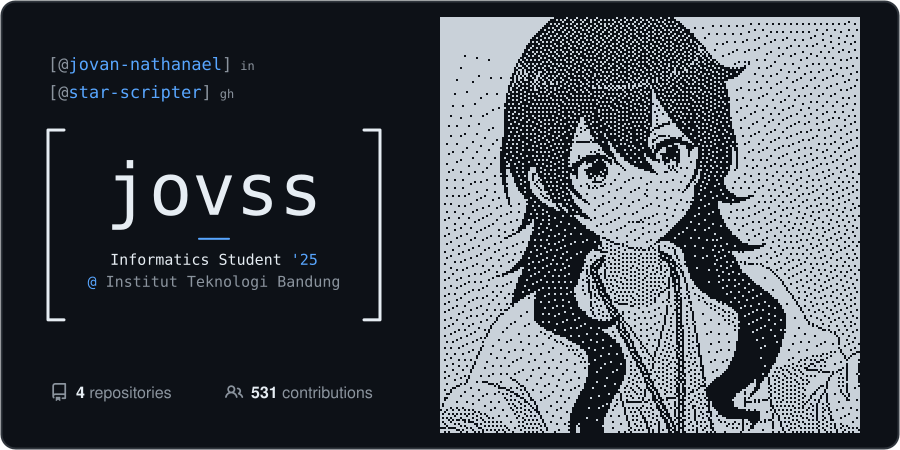
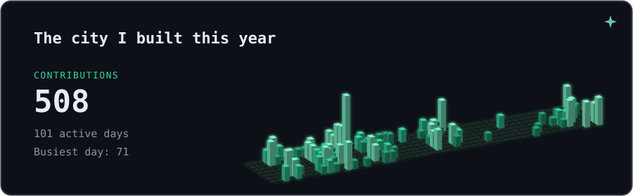
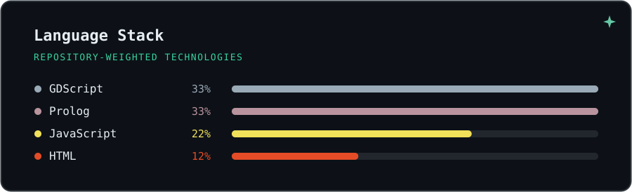
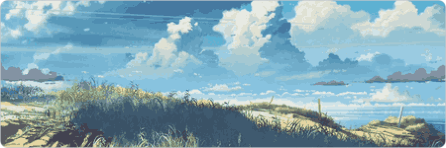

<picture>
  <source media="(prefers-color-scheme: dark)" srcset="assets/card-dark.svg">
  <source media="(prefers-color-scheme: light)" srcset="assets/card-light.svg">
  
</picture>

<!-- [LinkedIn](https://www.linkedin.com/in/jovan-nathanael) · [GitHub](https://github.com/star-scripter?tab=repositories) --> 

<picture>
  <source media="(prefers-color-scheme: dark)" srcset="assets/city-dark.svg">
  <source media="(prefers-color-scheme: light)" srcset="assets/city-light.svg">
  
</picture>

<picture>
  <source media="(prefers-color-scheme: dark)" srcset="assets/languages-dark.svg">
  <source media="(prefers-color-scheme: light)" srcset="assets/languages-light.svg">
  
</picture>

